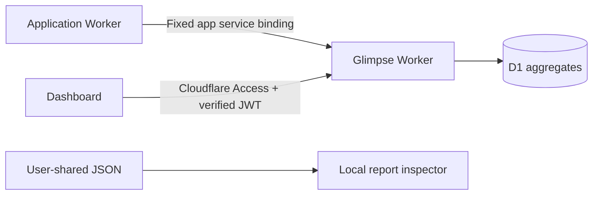

<p align="center">
  <picture>
    <source media="(prefers-color-scheme: dark)" srcset="public/brand/logo.svg">
    
  </picture>
</p>

<h1 align="center">Glimpse</h1>

<p align="center">Private analytics for OpenZCAD, OpenFEA, and OpenLattice3D.</p>

<p align="center">
  <a href="https://glimpse.esau.app/demo">Try the public demo</a> ·
  <a href="https://glimpse.esau.app">Private dashboard · Access required</a> ·
  <a href="docs/SETUP.md">Setup</a> ·
  <a href="docs/PRIVACY.md">Privacy</a> ·
  <a href="docs/VALIDATION.md">Validation & rollout</a>
</p>

Glimpse brings application activity, performance, storage, and diagnostics into a
protected dashboard. It uses one Cloudflare Worker, a dedicated D1 database, and
fixed service bindings from each application. Measurements become daily
aggregates; voluntarily shared diagnostic reports can be inspected locally.

## Try it

[Open the public demo](https://glimpse.esau.app/demo) to explore the dashboard
with fictional data. Try the app and date filters; browse Issues, Storage, and
Privacy; or load the sample diagnostic report. All demo numbers
are generated in your browser, with no connection to live analytics.

The demo runs on a separate `glimpse-demo` Worker with static assets only: no
D1 database, service bindings, ingestion, or credentials. Its files stay under
`/demo/`. Only that path has a Cloudflare Access bypass; the live dashboard and
`/api/stats` remain protected by Access and Worker JWT verification.

## Inside the dashboard

- **Overview:** utilization — opted-in cloud accounts, projects, and revisions
  with growth, workspaces opened, per-app activity, top CAD operations, feature
  categories, simulation workflow steps, and model complexity.
- **Issues:** server errors, diagnostic codes, failed exports, solves, and
  generations, cloud request failures, slow operations, and a local JSON report
  inspector with file and paste support.
- **Storage:** OpenZCAD cloud storage, growth, project sizes, and snapshot
  history; saved, upload, and download size observations.
- **Privacy:** collection definitions, consent scopes, retention, and measurement
  limits alongside the numbers.
- **Cloudflare:** Esau metered costs, subscriptions, app/resource usage, allocated
  cost estimates, budgets and collection coverage. See the
  [connection and rollout guide](docs/CLOUDFLARE.md); activation is separate.

The dark, responsive interface includes UTC date ranges of up to 90 days,
URL-backed filters, accessible data tables, and manual refresh. Basic and opt-in
figures load side by side and stay labelled by source. Empty, unsupported,
unavailable, and stale results have distinct states. Candidate metrics that are
not collected yet are listed in [proposed metrics](docs/PROPOSED-METRICS.md).

### Application coverage

| Application | Measurements supported by the service |
| --- | --- |
| **OpenZCAD** | API counters; opt-in CAD operations, exports, diagnostics, size/part/transfer observations; cloud account and storage snapshots with separate account permission |
| **OpenFEA** | API counters; opt-in mesh/solver/export outcomes, workflow steps, diagnostics, and size/part/transfer observations. No cloud account census |
| **OpenLattice3D** | API counters; opt-in workspace opens, export and generation outcomes, and operation timing. Expanded v2 metrics and local reports do not apply |

Support in this repository does not establish that an integration is enabled or
verified in production. The [validation ledger](docs/VALIDATION.md) records prior
checks and remaining rollout work; the [setup guide](docs/SETUP.md) covers the
required migrations and deployment order.

## How data reaches Glimpse



`OpenZCADIngest`, `OpenFEAIngest`, and `OpenLattice3DIngest` fix the caller's app
identity. `record({ level, event, bucket })` validates an allowlisted metric and
increments its UTC receipt-day counter. OpenZCAD also has a `snapshot(...)`
entrypoint for aggregate cloud statistics. There is no public HTTP ingestion
endpoint. Authenticated dashboard reads use `/api/stats`.

Daily counters and the latest snapshot per app/day are stored separately.
Snapshots represent stocks at a point in time and are never summed across days;
generation checks discard duplicate or out-of-order deliveries. Aggregates are
retained for 90 UTC calendar days, with expired rows excluded from reads and
removed by a daily job.

## Collection and interpretation

**Basic** counters measure server-side API requests, HTTP 5xx failures, and coarse
response times. They count operations, not people, visits, or browser-local work.

**Optional** analytics require an enabled app deployment switch and explicit
app-local consent. Expanded OpenZCAD/OpenFEA collection requires fresh v2 consent;
OpenZCAD account statistics have a separate, expiring permission. Optional totals
describe the opted-in population only. Workflow steps are independent counts,
not individual timelines.

Glimpse's analytics schema excludes visitor identifiers, IPs, URLs, model content,
project names, and raw error text or stacks. It stores no raw event history.
Infrastructure and authentication logs have separate settings and retention; see
the [privacy review](docs/PRIVACY.md) for that boundary.

Reports stay in the current browser page and never enter the aggregate database.
The inspector accepts only validated v2 JSON, up to 64 KiB and 128 unique aggregate
rows. Clear or reload removes the inspected report.

These are best-effort operational measurements. Lost or spoofed events, rate
limits, repeated observations, and consent selection can affect totals. They are
not billing records or unique-user estimates.

## Development

Use **Node.js 22.12 or newer** and npm.

```sh
npm ci
npm run check
npm run dev
```

`npm run dev` serves the dashboard UI on loopback only. It needs a configured
Worker API for real data; an unavailable API produces an error state. Follow
[setup](docs/SETUP.md) for local D1 migrations, `wrangler dev`, and Access
configuration. Keep development servers private.

| Command | Purpose |
| --- | --- |
| `npm run dev` | Start the Vite UI development server |
| `npm run build:demo` | Build the isolated public demo into `dist-demo/` |
| `npm run dev:demo` | Serve the demo Worker locally on port 8788 |
| `npm run build` | Build dashboard assets into `dist/` |
| `npm run typecheck` | Check TypeScript without emitting files |
| `npm test` | Run Worker/RPC/D1/auth, dashboard-data, and preview-isolation regressions |
| `npm run check:deploy` | Remove `dist/`, prove a clean Wrangler dry-run builds assets, and verify bundle references |
| `npm run check` | Run typechecking, tests, and both deployment dry-runs |
| `npm run types` | Regenerate Cloudflare binding types after configuration changes |

CI also runs the privacy-policy regressions:

```sh
python3 -m unittest discover -s scripts -p 'test_*.py'
```

The stack is TypeScript, React 19, Vite, native CSS/SVG charts, Cloudflare Workers,
D1, and Cloudflare Access. No external fonts or chart/UI libraries are loaded.

## Deployment

The configured dashboard hostname is [glimpse.esau.app](https://glimpse.esau.app).
Dashboard assets and API reads require Cloudflare Access, with JWT verification
inside the Worker. Branch previews use a separate D1 database and Access audience.

GitHub Actions validates changes. The existing Cloudflare Workers Builds
integration deploys pushes to `main`, using `npm run build`,
`npx wrangler deploy`, and root directory `/`. Direct Wrangler deployments also
build the UI through the custom build configuration.

Service deployment, database migrations, app integration rollout, and collection
activation are separate steps. Follow the [setup guide](docs/SETUP.md) and
[expanded analytics rollout](docs/EXPANDED-ANALYTICS.md); a passing dry-run does
not migrate or deploy anything.

## Project guide

| Location | Contents |
| --- | --- |
| [`src/`](src/) | Worker, Access verification, metric/census contracts, report validation |
| [`web/`](web/) | Dashboard views, charts, filters, and local report inspector |
| [`migrations/`](migrations/) | Ordered D1 schema migrations |
| [`test/`](test/) | Service, data-semantics, and preview-configuration regressions |
| [`scripts/`](scripts/) | Clean-build verification and publication/privacy checks |
| [`public/brand/`](public/brand/) | Reveal logo, wordmarks, and app icon |

| Documentation | Details |
| --- | --- |
| [Setup & rollout](docs/SETUP.md) | Bindings, migrations, Access, builds, previews, and rollback |
| [Privacy & consent](docs/PRIVACY.md) | Collection boundaries, consent, and infrastructure limits |
| [Expanded analytics](docs/EXPANDED-ANALYTICS.md) | Measurement definitions, account permission, reports, and v2 rollout |
| [Validation ledger](docs/VALIDATION.md) | Recorded local/hosted checks and unverified production work |
| [Dashboard design](docs/DASHBOARD-DESIGN.md) | Interface behavior and measurement presentation |
| [Proposed metrics](docs/PROPOSED-METRICS.md) | Candidate opt-in and snapshot metrics awaiting privacy review |
| [Brand](docs/BRAND.md) | Logo variants, palette, and icon exports |
| [Public-source review](docs/PUBLICATION.md) | Bounded history review and ongoing commit/secret checks |

Changes to the event vocabulary in [`src/contract.ts`](src/contract.ts) or the
expanded schemas in [`src/expanded.ts`](src/expanded.ts) require coordinated app
adapter changes and a privacy review. Keep changes focused, add regression
coverage for behavior changes, and run the checks above before opening a pull
request. Keep secrets, real reports, model files, and production data out of
issues, tests, and commits.
